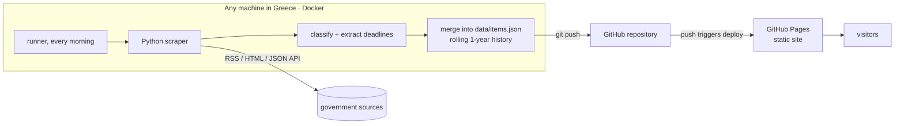

# Κύρβεις (Kyrbeis)

> *In ancient Athens, laws were written on wooden tablets called **kyrbeis** and set up in public for everyone to read. Kyrbeis does the same for today's Greek public announcements.*

**Tax deadlines, subsidies and funding programs from Greek government sites, collected automatically every morning into one searchable, bilingual website.**

[](https://github.com/ThanosTheodorakis/kyrbeis/actions/workflows/ci.yml)
[](https://github.com/ThanosTheodorakis/kyrbeis/actions/workflows/update.yml)

**Live site:** https://thanostheodorakis.github.io/kyrbeis/

<!-- Add a screenshot of the live site here, e.g.  -->

## The problem

Information Greek citizens and small businesses need to act on is spread across many sites. That includes tax deadlines from AADE, EU-funded calls on ESPA, new subsidies announced by ministries, and social-security payment dates from e-EFKA. Each site has its own layout and none of them offer one place to see *what's due soon*. Missing a deadline can mean a fine; missing a call can mean missing funding.

## What it does

- **Collects** announcements daily from 12 official sources: AADE (including farm subsidy payments), the Ministries of Finance, Development, Labour, Environment & Energy and Social Cohesion & Family, e-EFKA, DYPA, OPEKA, the Hellenic Development Bank, the Prime Minister's office and the Diavgeia open-data API. Most are read from RSS feeds or an API; the rest from their web pages. ESPA and the Recovery Fund site are configured but switched off, because they don't answer automated requests (see *Limitations*).
- **Classifies** each one by topic (*tax & deadlines*, *subsidies*, *programs*) and by audience (*households*, *businesses*, *employees*, *pensioners*, *farmers*) with accent-insensitive Greek keyword matching. It knows, for example, that «μη μισθωτοί» are the self-employed, not employees.
- **Extracts deadlines** from free Greek text ("έως 30 Νοεμβρίου 2026", "μέχρι 15/12"). It prefers the date after «έως/μέχρι», ignores start dates after «από», gives a date without a year the year closest to the announcement, and takes the *new* date when a post announces a παράταση (extension).
- **Publishes** a static website with:
  - a 60-day timeline of upcoming deadlines, with anything due within 7 days highlighted
  - full-text search and filters by topic, **who it's for** (households, businesses, employees, pensioners, farmers), deadline status (open, due within 7 or 30 days), publication date and agency, plus sorting by nearest deadline. Filters are kept in the URL, so a filtered view can be shared as a link
  - a Greek/English interface, dark mode, and a layout that works on phones
  - a **calendar subscription** (a `webcal://` link, so calendar apps keep it updated) and an **RSS feed**
  - a source-health panel showing which sites responded on the last run

## How it works



Collecting and publishing are split on purpose:

- **A machine in Greece collects.** A Docker container keeps a clone of the repository and, every morning, gets the latest code, runs the scraper from a Greek internet connection, then commits and pushes the new data. Government sites see an ordinary Greek visitor, not a data-centre abroad. The container only needs Docker, so it moves between a laptop, a desktop or a small server with one command, and it only makes outgoing connections.
- **GitHub publishes.** Each push of `data/` triggers a deploy of the static site to GitHub Pages. Hosting is free, and if the computer is off for a day, the site stays up with the last data.

The git history doubles as a day-by-day archive of the data.

### Design decisions

| Decision | Why |
|---|---|
| Static site instead of a backend | Free hosting, nothing to keep alive, and the data is versioned in git |
| Collect on a computer in Greece, publish on GitHub | Requests come from a Greek connection, and the public site never depends on that computer being on |
| Collector in Docker | Moving it to another machine means copying one folder and running `docker compose up -d`: no Python, Git or scheduler to set up. It schedules itself, catches up after the machine was off, and restarts after a reboot |
| Push with a fine-grained token | The container can push to this one repository and nothing else; the token is read from the environment and never written to disk |
| Cross-platform by design | Without Docker the collector is plain Python, every file is read and written as UTF-8, and the tests run on Windows, macOS and Linux |
| One source failing doesn't fail the run | Government sites are often slow or down. A failed page doesn't drop the rest of its source, and the job only fails if *every* source fails |
| Small daily commits | Unchanged announcements produce byte-identical files, so a day without news only commits the small status file |
| Prefer RSS, fall back to HTML | Feeds are stable; for HTML pages there's a configurable CSS-selector mode and a headline-detection heuristic |
| Polite fetching | Honours robots.txt and Crawl-delay, per-host rate limit, retries only errors that can clear (429, 5xx, timeouts), and a User-Agent with a contact link |
| All dates in Europe/Athens | Whatever time zone the computer or GitHub's servers (UTC) use, dates near midnight stay correct |
| Accent-insensitive, word-start matching | Greek text mixes «Προθεσμία», «ΠΡΟΘΕΣΜΙΑ» and «προθεσμια». Matching at the start of a word stops «δόση» from matching «έκδοση» |
| Vanilla JS, no framework or build step | Loads fast, and the site is three files you can read in one sitting |

## Tech stack

**Scraper:** Python 3.11+, requests, BeautifulSoup, lxml  
**Front end:** HTML, CSS, vanilla JavaScript  
**Collection:** Docker (self-scheduling container), git  
**Automation:** GitHub Actions (deploy on push; tests on Windows, macOS and Linux; ruff linting; Docker image build and checks), GitHub Pages  
**Formats produced:** JSON, iCalendar (RFC 5545), RSS 2.0

## Run it locally

You need [Python 3.11+](https://www.python.org/downloads/) and [Git](https://git-scm.com/downloads).

```bash
git clone https://github.com/ThanosTheodorakis/kyrbeis.git
cd kyrbeis
python -m venv .venv
```

Activate the environment: `.venv\Scripts\activate` on Windows, `source .venv/bin/activate` on macOS and Linux. Then:

```bash
pip install -e ".[dev]"                        # the project, plus pytest and ruff
python -m scraper.gov_scraper --site-data data # scrape and update data/
python scripts/serve.py                        # preview at http://localhost:8000
```

Other commands:

```bash
python -m scraper.gov_scraper --only aade -v   # one source, verbose
python -m scraper.gov_scraper --new-only       # digest of items not seen before, in output/
pytest                                         # offline tests, no network needed
```

Dependencies are declared in `pyproject.toml`; install with `-e` (editable), because the collector works inside this folder.

## Deploy your own copy

### 1. Publish the site on GitHub

1. Push this folder to a new GitHub repository.
2. **Settings → Pages → Build and deployment → Source:** choose **GitHub Actions**.
3. **Settings → Actions → General → Workflow permissions:** choose **Read and write permissions**.
4. **Actions → Deploy site → Run workflow** to publish the first version. Tick *"Also run the scraper here"* if `data/` is still empty.
5. If you fork this, replace `ThanosTheodorakis/kyrbeis` in this README with your username and repository name.

### 2. Collect the data with Docker

You need [Docker](https://docs.docker.com/get-docker/) on the machine that will collect: Docker Desktop on Windows or macOS, Docker Engine on Linux.

**Create a token** so the container can push to your repository and nothing else. On GitHub: **Settings → Developer settings → Personal access tokens → Fine-grained tokens → Generate new token**:
- *Repository access:* **Only select repositories** → your `kyrbeis` repository
- *Permissions → Repository permissions → Contents:* **Read and write**
- *Expiration:* up to a year; set a reminder to renew it

**Start it** in the project folder:

```bash
cp .env.example .env          # Windows: copy .env.example .env
# edit .env: REPO_URL, GITHUB_TOKEN, and optionally RUN_AT (default 06:17 Athens time)
docker compose up -d --build
```

On first start the container clones your repository, then collects every day at `RUN_AT`. If the machine was off at that time, it collects as soon as it starts again. It restarts by itself after a reboot (on Windows and macOS, let Docker Desktop start when you sign in).

| To | Run |
|---|---|
| See what it's doing | `docker compose logs -f` |
| Collect right now | `docker compose run --rm kyrbeis once` |
| Stop it | `docker compose down` |
| After the dependencies in `pyproject.toml` change | `docker compose up -d --build` |

**Moving to another machine:** copy the project folder with your `.env` to it and run `docker compose up -d --build`. The data lives on GitHub, so nothing else needs moving. Stop the old one first, so two machines don't collect at once.

**If the machine is off for a while,** the site keeps showing the last data. To refresh it anyway, use **Actions → Deploy site → Run workflow** with *"Also run the scraper here"* ticked.

### Without Docker

The same collection runs with plain Python on Windows, macOS or Linux. Set up the project as in *Run it locally* (clone **your** repository, and make sure `git push` works), then run `python -m scraper.update` (or `--no-push` to try it without pushing). Each run is logged to `update.log`.

To run it daily, use **Task Scheduler** on Windows (program: `.venv\Scripts\python.exe`, arguments: `-m scraper.update`, start in: the project folder; tick *Run task as soon as possible after a scheduled start is missed*), or cron on macOS and Linux:

```
0 9 * * *  cd "$HOME/kyrbeis" && .venv/bin/python -m scraper.update
```

## Adding or fixing a source

Sources are configured in [`scraper/sources.json`](scraper/sources.json) without code changes. The bundled HTML sources use the headline-detection fallback. For more precise results, open the page in a browser, inspect one announcement and add CSS selectors. This example shows the shape; the class names depend on the site:

```json
{
  "name": "example",
  "label": "Example agency",
  "type": "html",
  "url": "https://www.example.gov.gr/announcements",
  "item_selector": "article.news-item",
  "date_selector": "time"
}
```

Types: `rss`, `html`, `rss_or_html` (tries a feed and falls back to HTML) and `diavgeia` (open-data API search).

Other options per source:

| Option | Effect |
|---|---|
| `keep_all: true` | keep every item, even when no topic keyword matches |
| `require_date: true` | drop items without a date (useful when menu links slip in) |
| `expect_items: false` | 0 results is normal; by default 0 results is reported as a failure, since it usually means the page layout changed |
| `enabled: false` + `note` | skip the source but list it on the site as unavailable, with the reason |

Topic keywords live in `CATEGORIES` in `scraper/gov_scraper.py`. They match at the start of a word with accents and case ignored, so `επιδοτηση` also matches «Επιδότησης». End a keyword with `!` to require the whole word: `pass!` matches «Fuel Pass» but not «password».

## Limitations

- Classification is keyword-based, so some items land in the wrong topic or are missed.
- HTML scraping breaks when a site redesigns. The source-health panel shows when that happens, and the fix is usually one CSS selector.
- ESPA (espa.gr) resets connections from the scraper, so both ESPA sources are disabled. The scraper doesn't pretend to be a browser to get around this. espa.gr only lists RSS feeds for its 2014–2020 site; a working feed for current calls could be added as an `rss` source.
- Collection depends on the collecting machine being on with internet. A missed day is caught up when it's back, and the site stays online meanwhile.

## Roadmap

- Email or Telegram alerts for new items matching a saved search
- Better classification with a small trained model on labelled announcements
- Per-item pages with the full announcement text and attachments

## Disclaimer

This is an unofficial project. Information is collected automatically and may be incomplete or wrong. Always check the official announcement before acting on it.

## License

[MIT](LICENSE)
